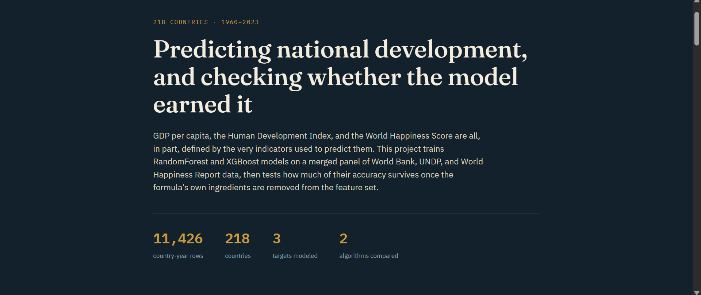
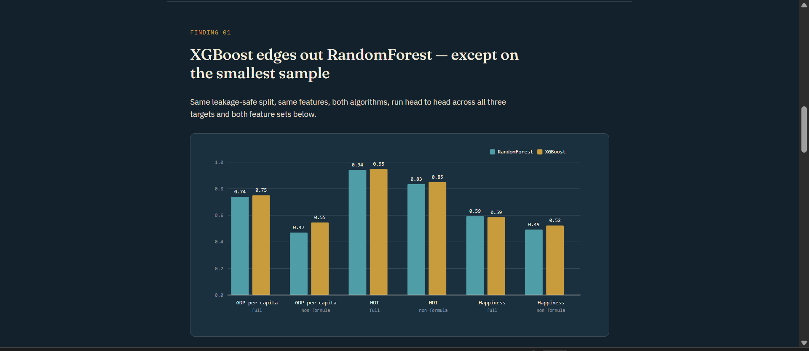
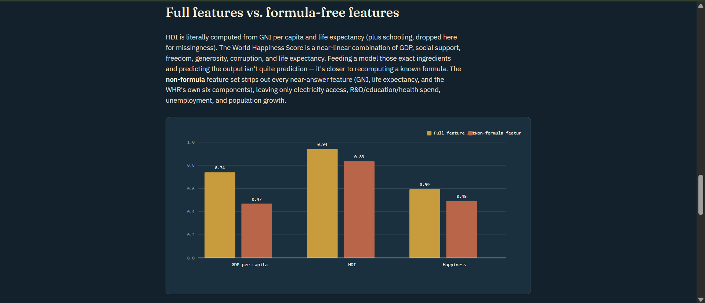
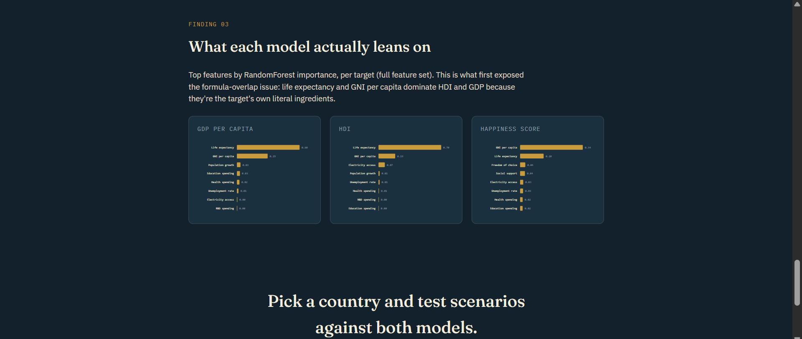

# Country Development Indicator Predictor

An end-to-end machine learning project for predicting country-level development indicators using socioeconomic data from the World Bank, UNDP, and World Happiness Report.

The project compares **Random Forest and XGBoost** for predicting three development outcomes:

- GDP per capita
- Human Development Index (HDI)
- World Happiness Score

Beyond comparing model performance, the project investigates **formula overlap and target leakage** — examining how much predictive performance depends on input features that are themselves ingredients in the target's calculation.

**Live Demo:** [Country Development Predictor](https://developmental-predictor.onrender.com/)

## Highlights

- Combines socioeconomic indicators from multiple international data sources
- Covers 218 countries and 11,426 country-year rows
- Predicts GDP per capita, HDI, and Happiness Score
- Compares Random Forest and XGBoost models
- Evaluates full-feature and formula-free feature sets
- Investigates how target construction affects apparent predictive accuracy
- Visualizes feature importance for each prediction target
- Includes an interactive country-level prediction interface
- Supports what-if scenario exploration through adjustable socioeconomic indicators

## Dataset

The project uses a merged country-year dataset based on:

- **World Bank:** Economic, infrastructure, population, and development indicators
- **UNDP:** Human Development Index and related development measures
- **World Happiness Report:** Happiness scores and associated indicators

The dataset contains:

- 11,426 country-year rows
- 218 countries
- Historical observations spanning 1960–2023
- Three prediction targets: GDP per capita, HDI, and Happiness Score

The number of available observations varies by indicator because the source datasets have different coverage periods and missing values.

## Methodology

```text
World Bank Data
       |
       +-------------------+
       |                   |
       v                   v
    UNDP Data        World Happiness Data
       |                   |
       +---------+---------+
                 |
                 v
       Merge Country-Year Data
                 |
                 v
       Data Cleaning & Preparation
                 |
                 v
       Feature and Target Selection
                 |
          +------+------+
          |             |
          v             v
    Full Features   Formula-Free
          |             |
          +------+------+
                 |
                 v
       +---------------------+
       | Random Forest       |
       | XGBoost             |
       +---------------------+
                 |
                 v
       Evaluate Three Targets
                 |
                 v
       Compare Model Performance
                 |
                 v
       Feature Importance Analysis
                 |
                 v
       Interactive Prediction App
```

## Why Investigate Formula Overlap?

Some development indicators are mathematically or conceptually related to the variables used to predict them.

For example:

- HDI incorporates dimensions related to income, health, and education.
- GDP per capita is closely related to measures of national income.
- Happiness scores are associated with factors such as GDP per capita, social support, healthy life expectancy, freedom, generosity, and perceptions of corruption.

If a model receives variables that closely reproduce the target's construction, it may achieve strong metrics without demonstrating equally strong generalization from independent socioeconomic indicators.

The project therefore compares:

- **Full-feature models:** Use the selected full set of input features.
- **Formula-free models:** Exclude selected features that directly overlap with target construction.

This comparison helps investigate how performance changes when formula-related inputs are removed.

## Models Compared

| Model | Description |
|---|---|
| Random Forest | Ensemble of decision trees trained using randomized samples and feature selection |
| XGBoost | Gradient-boosted decision trees that learn sequentially from previous errors |

Both algorithms are evaluated on the same targets and corresponding feature sets to support a meaningful comparison.

## Results

The live dashboard reports the following model comparison results.

### Full Features vs. Formula-Free Features

| Target | Model | Full-feature R² | Formula-free R² |
|---|---|---:|---:|
| GDP per capita | Random Forest | 0.74 | 0.47 |
| GDP per capita | XGBoost | 0.75 | 0.55 |
| HDI | Random Forest | 0.94 | 0.83 |
| HDI | XGBoost | 0.95 | 0.85 |
| Happiness Score | Random Forest | 0.59 | 0.49 |
| Happiness Score | XGBoost | 0.59 | 0.52 |

*Values are taken from the model-comparison charts displayed on the deployed dashboard.*

XGBoost achieves the highest displayed R² for each target and feature configuration, although some differences are small.

The decline in performance for formula-free feature sets is especially noticeable for GDP per capita. This supports the project's central investigation: a model's apparent predictive performance can depend substantially on how its input features relate to the target's construction.

These results are specific to the evaluated data and split; they do not establish that one algorithm will always outperform the other.

## Feature Importance

Feature-importance analysis helps identify which socioeconomic indicators the models rely on most heavily.

The dashboard presents separate importance visualizations for GDP per capita, HDI, and Happiness Score.

The displayed results highlight the importance of examining feature-target relationships rather than interpreting high predictive scores in isolation.

Feature importance indicates how a model uses its inputs; it does not establish that a feature causes changes in a country's development outcomes.

## Interactive Predictor

The project includes a deployed web interface for exploring country-level predictions.

Users can:

- Select a country and year
- Switch between Random Forest and XGBoost
- Adjust socioeconomic indicators using interactive sliders
- Compare reported values with model estimates
- Explore hypothetical input scenarios
- View predictions for GDP per capita, HDI, and Happiness Score

### Live Application

[Open the Country Development Predictor](https://developmental-predictor.onrender.com/)

### Dashboard Overview


### Interactive Country Prediction



### Random Forest vs. XGBoost


### Full Features vs. Formula-Free Features


### Feature Importance



## Technology Stack

- **Language:** Python
- **Machine Learning:** scikit-learn, XGBoost
- **Data Processing:** pandas, NumPy
- **Visualization:** Matplotlib and web-based charts
- **Interactive Interface:** Streamlit
- **Deployment:** Render
- **Experimentation:** Jupyter Notebook

## Project Structure

```text
Country-Development-Predictor/
|
├── README.md
├── requirements.txt
├── .gitignore
|
├── app.py
|
├── data/
│   └── merged_development_data_full.csv
|
├── notebooks/
│   ├── data_preprocessing_and_neural_network.ipynb
│   ├── random_forest_model.ipynb
│   └── random_forest_model_experiment.ipynb

```


## Limitations

- Data coverage and missingness vary across countries, years, and indicators.
- Socioeconomic relationships can change over time and across regions.
- Formula overlap can inflate apparent predictive performance.
- Feature importance does not imply causality.
- Slider-based what-if scenarios are model outputs, not causal policy forecasts.
- The reported results depend on the selected features, data split, and evaluation methodology.
- The deployed interface and the repository's locally uploaded model artifacts may not yet be fully synchronized.

## Future Improvements

- Temporal and country-grouped validation to test generalization
- Hyperparameter optimization for both algorithms
- Uncertainty intervals for predictions
- Better handling of missing indicators
- More systematic formula-overlap and leakage analysis
- Country-level and year-level error analysis
- Explainability with SHAP
- Reproducible model artifacts and data-version tracking
- Expanded scenario analysis with appropriate uncertainty warnings

